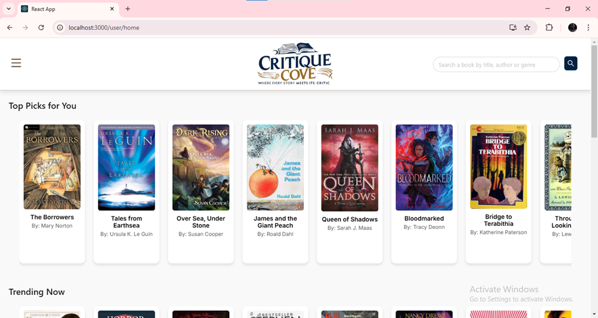
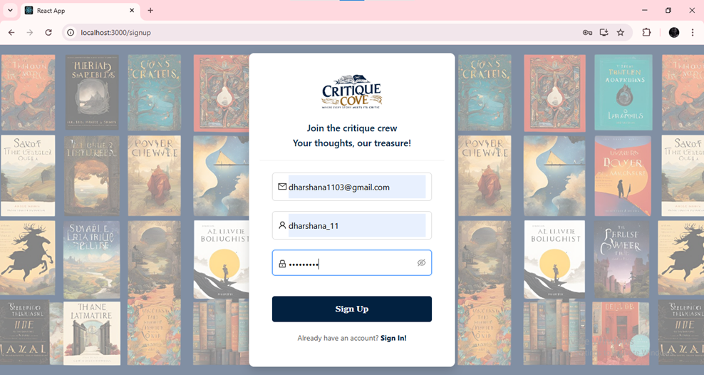
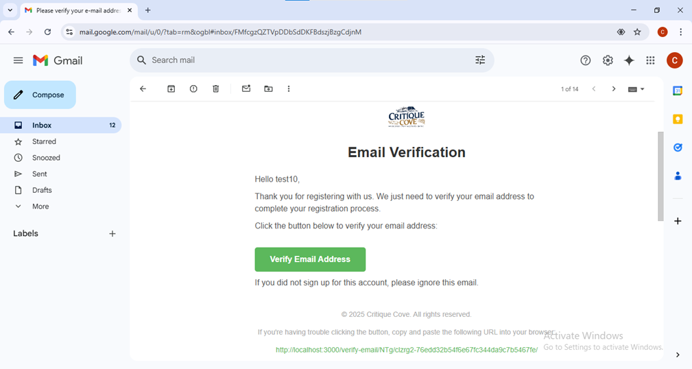
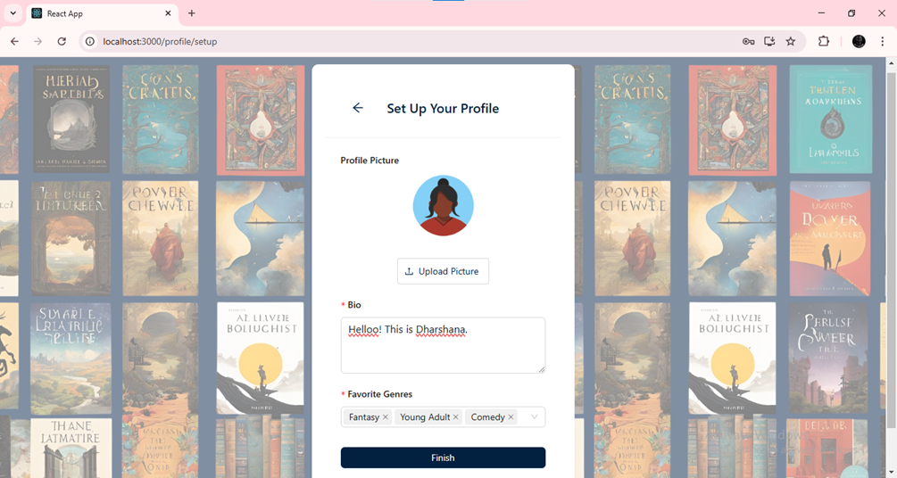
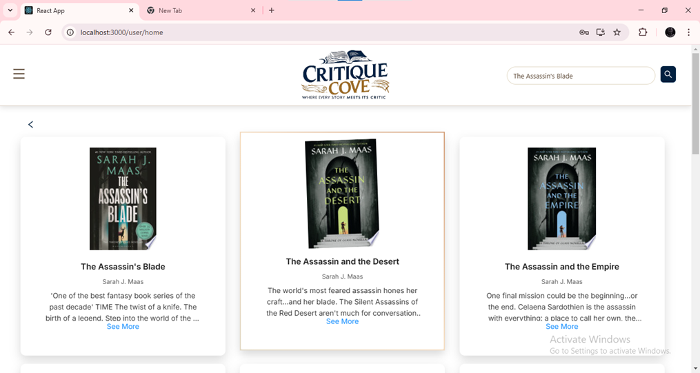
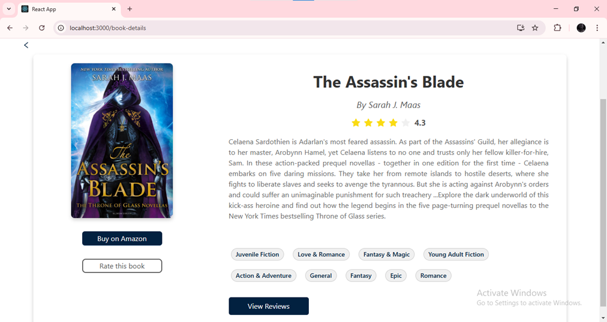
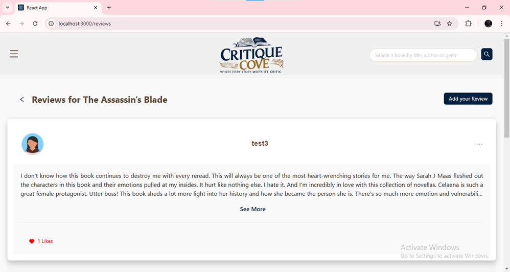
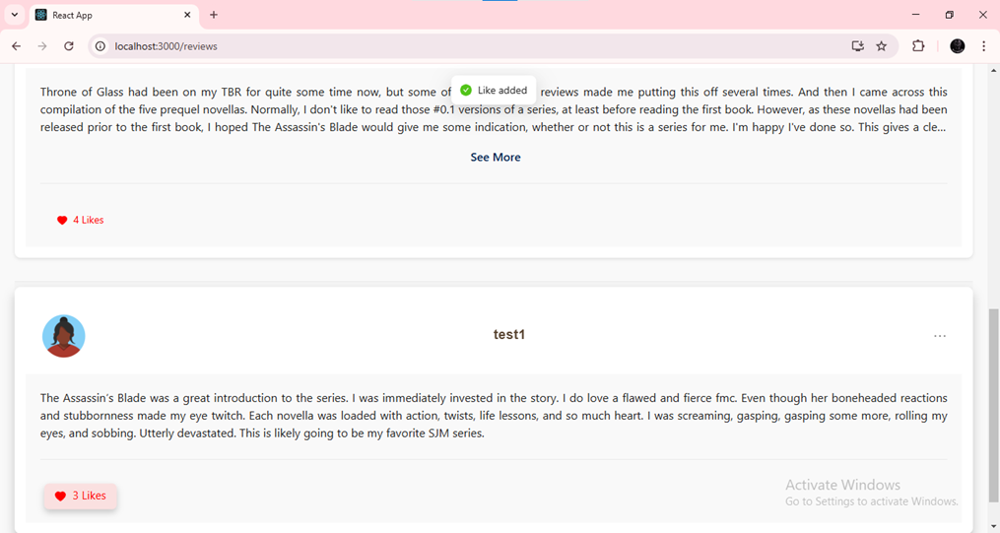
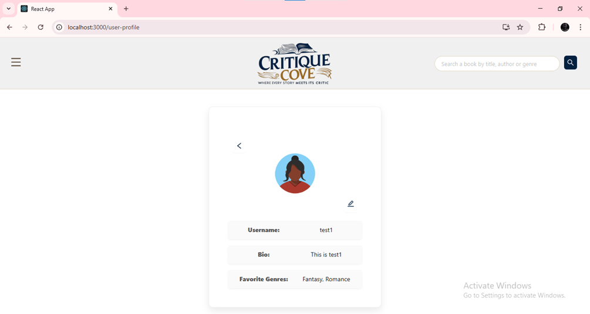
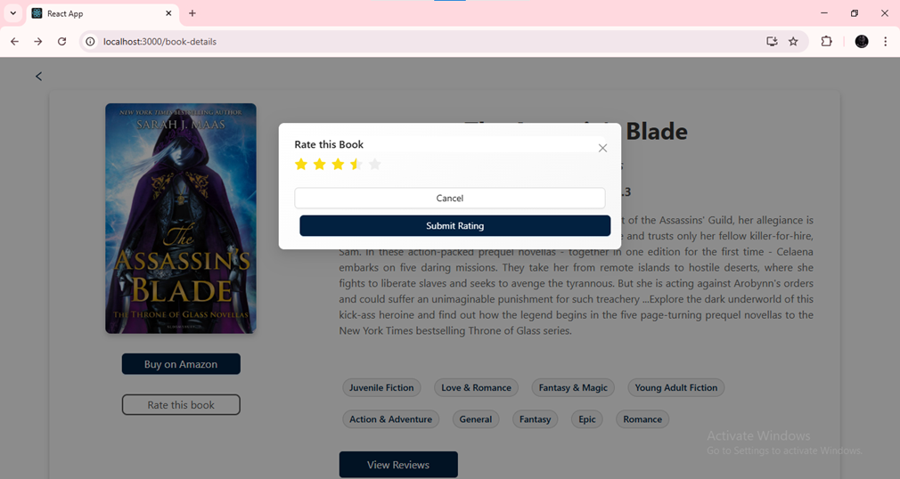

# Book Review Platform

A full-stack web application where users can **search for books, read and write reviews, rate books, and get personalized recommendations**. Built with **ReactJS** for the front-end, **Django** for the back-end, and **SQLite** as the database. Integrates with the **Google Books API** to fetch book details.

---

## Run locally

```bash
# backend
python -m venv .venv && source .venv/bin/activate
pip install -r requirements.txt
cd book_review_platform
python manage.py migrate          # creates db.sqlite3 and seeds the genres
python manage.py runserver        # http://127.0.0.1:8000

# frontend (second terminal)
cd book_review_platform/frontend
cp .env.example .env.local        # optional: API URL, Google Books key
npm install
npm start                         # http://localhost:3000
```

With no configuration, verification and password-reset e-mails are **printed in the backend console**. To send real e-mail or to deploy, set the environment variables listed in `book_review_platform/.env.example` (`DJANGO_SECRET_KEY` is mandatory when `DJANGO_DEBUG=0`). Secrets are never read from source code.

## Tests

```bash
cd book_review_platform && python manage.py test        # 37 backend tests
cd book_review_platform/frontend && CI=true npm test -- --watchAll=false
```

---

## Tech Stack
- **Front-end:** ReactJS, Ant Design, HTML, CSS, JavaScript  
- **Back-end:** Django, Django REST Framework  
- **Database:** SQLite  
- **APIs:** Google Books API  

---

## Features

- **User Registration & Login:** Secure authentication with email verification.  
- **Profile Setup & Management:** Users can update their profile information.  
- **Book Search:** Search books by title, author, or ISBN using the Google Books API.  
- **Book Details:** View detailed information including description, authors, and cover images.  
- **Reviews:** Write, edit, and delete book reviews.  
- **Ratings:** Rate books and view average ratings.  
- **Like & Unlike Reviews:** Interact with other users’ reviews.  
- **Personalized Recommendations:** Get book suggestions based on user activity.  

---

## Screenshots

### Home Page


### User Authentication




### Book Search


### Book Details


### Reviews



### Profile Page


### Book Rating


---


## Skills Demonstrated
 - ReactJS component design and state management
 - Integration of REST APIs and handling asynchronous requests
 - User authentication and authorization with Django
 - CRUD operations and database management with SQLite
 - Responsive web design using Ant Design

---

## Future Enhancements
 - Add AI-based book recommendations
 - Implement user book collections and reading lists
 - Add social features like following users and commenting

## Live Demo
[Click here to view the live app](https://book-review-platform-8cmgeb0i6-dharshana-11s-projects.vercel.app)
